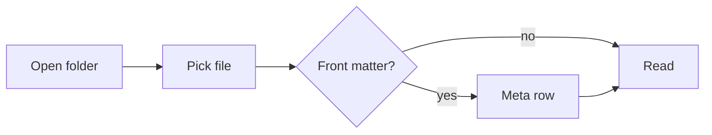

# Rendering fixture

This file exercises every rendering feature Metrodown supports. Open it after any renderer
change and scan it top to bottom. Links: [the spec](spec.md), [its acceptance list](spec.md#acceptance),
[the README](../README.md), [a section below](#code-blocks) and <https://github.com>.

## Text

Plain paragraph with **bold**, *italic*, ~~strikethrough~~, `inline code`, and a keyboard hint:
<kbd>Ctrl</kbd> + <kbd>O</kbd>. Korean text should render with the same rhythm: 마크다운 문서를
읽기 편하게 보여주는 뷰어입니다.

> A plain blockquote stays a quote. It should read as a quieter aside, not as an alert.

---

## Alerts

> [!NOTE]
> Useful information that users should know, even when skimming content.

> [!TIP]
> Helpful advice for doing things better or more easily.

> [!IMPORTANT]
> Key information users need to know to achieve their goal.

> [!WARNING]
> Urgent info that needs immediate user attention to avoid problems.

> [!CAUTION]
> Advises about risks or negative outcomes of certain actions.

## Lists

1. First step
2. Second step, with a nested list:
   - nested bullet
   - another bullet
     1. deeper ordered item
3. Third step

### Task list

- [x] Opens a folder and lists only Markdown files
- [x] Renders alerts and highlighted code
- [ ] Reloads the open file when it changes on disk
- [ ] Remembers scroll position

## Tables

| Feature | Owner | Budget | Status |
|:--------|:-----:|-------:|--------|
| Cold start | backend | 400 ms | Ready |
| Open 1 MB file | renderer | 150 ms | Ready |
| Folder scan | backend | 500 ms | Planned |

## Code blocks

```rust
#[tauri::command]
fn read_markdown(path: String) -> Result<String, String> {
    // Read-only: the viewer never writes to disk.
    std::fs::read_to_string(&path).map_err(|e| e.to_string())
}
```

```typescript
export function slugify(text: string): string {
  return text.trim().toLowerCase().replace(/\s/g, "-");
}
```

```powershell
Get-ChildItem -Recurse -Filter *.md | Measure-Object
```

```diff
- old line
+ new line
```

```json
{ "status": "draft", "tickets": [1, 2, 3] }
```

```
A fence without a language stays plain text.
```

## Diagrams

### Text diagram

Box-drawing lines must join, and Korean text takes exactly two columns.

```
카드 명세서 ──▶ csv.ts ─────┐
(CSV/xlsx)      xlsx.ts     │
                            ├──▶ Txn[] ──▶ detect.ts ──▶ Series[] ─┐
Gmail / JSON ──▶ gmail.ts ──┤                                      │
                 email.ts ──┘                                      ▼
                                                               사용자 확인
                                                                   │
                                                                   ▼
                              Subscription[] ──▶ money.ts ──▶ Totals
                                    │
                                    └────────▶ analyze.ts ──▶ Finding[]
```

### Mermaid



### Pasted SVG chart

A chart exported as SVG without its stylesheet: it keeps its natural 240px width, its labels
(HTML inside `foreignObject`) show, and the arrowhead follows the theme.

<svg width="100%" viewBox="0 0 240 150" style="max-width: 240px;" xmlns="http://www.w3.org/2000/svg"><marker id="fx-arrow" viewBox="0 0 10 10" refX="5" refY="5" markerWidth="8" markerHeight="8" orient="auto"><path d="M 0 0 L 10 5 L 0 10 z"></path></marker><rect x="60" y="10" width="120" height="40" fill="none" stroke="currentColor"></rect><foreignObject x="60" y="18" width="120" height="24"><p>Oscillator</p></foreignObject><path d="M120,50L120,92" fill="none" stroke="currentColor" marker-end="url(#fx-arrow)"></path><rect x="60" y="100" width="120" height="40" fill="none" stroke="currentColor"></rect><foreignObject x="60" y="108" width="120" height="24"><p>필터</p></foreignObject></svg>

## Images


## Raw HTML

<details>
<summary>Expandable details</summary>

Hidden content inside a details element.

</details>

<script>document.body.innerHTML = "sanitizer failed";</script>

<p style="color: red">Inline styles are removed, so this paragraph uses the normal ink colour.</p>

## Long headings wrap without breaking the outline when the title runs longer than one line

Final paragraph. The outline's last stop should turn solid when you reach the end.
